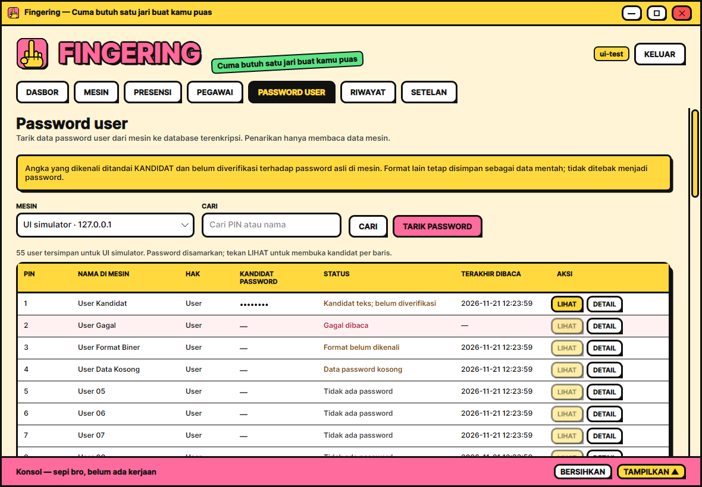

# Fingering — Penarik Presensi Fingerspot

Fingering adalah **rewrite aplikasi desktop penarik presensi dari mesin Fingerspot Revo**, dibangun dengan C#, Avalonia UI, dan .NET 10. Aplikasi memakai protokol FK lewat TCP, menyimpan presensi secara lokal dalam database terenkripsi, dan mengekspor rekap Excel.

Proyek independen milik illustricious, tidak berafiliasi dengan produsen Fingerspot. Implementasi sebelumnya menggunakan Go (`presensi-hub`).

## Fitur

- Uji koneksi, tarik seluruh log/rentang tanggal, sinkronisasi data baru, pantau jumlah log.
- Kelola pegawai/shift, hitung keterlambatan/lupa absen, ekspor XLSX.
- Tarik data password user (dialek FK `13_1`) dan lihat tabel per mesin, pencarian PIN/nama, status baca, kandidat angka tersamar, serta waktu penarikan.
- Database SQLCipher, kunci acak 256 bit, login dan kode pemulihan melalui vault AES-GCM.
- Backup `.fingbak` terenkripsi dengan sandi terpisah, migrasi database lama.
- Operasi hapus log/user dinonaktifkan secara bawaan, dengan pencadangan dan konfirmasi.

Saat pertama dibuka, buat ID dan sandi melalui setup. **Simpan kode pemulihan** yang ditampilkan. Instalasi baru tidak memiliki akun login bawaan.

Data berada di direktori ApplicationData pengguna, subfolder `illustricious/Fingering`: `%APPDATA%` pada Windows, `~/.config` pada Linux, `~/Library/Application Support` pada macOS. Gunakan `--data <folder>` untuk lokasi lain. Data presensi, sidik jari, sandi, vault dan backup tidak dimasukkan ke Git.

## Tarik password user

1. Buka tab **PASSWORD USER** (atau **MESIN → opsi lanjutan → PASSWORD USER**).
2. Pilih mesin, tekan **TARIK PASSWORD**. Aplikasi membaca daftar user dan data enroll password; tidak mengubah/hapus data di mesin.
3. Tabel menampilkan PIN, nama, hak akses, kandidat password, status dan waktu baca. Gunakan **LIHAT/TUTUP** untuk membuka/menyamarkan kandidat per baris; **DETAIL** menampilkan kegagalan dan data mentah bila dibuka secara sengaja.

**Angka yang tampil adalah kandidat teks, belum bukti password asli.** Hanya rekaman dengan header PIN/jenis yang sesuai serta field teks numerik 1–8 digit dengan padding nol yang dikenali. Nol di depan dipertahankan. Format biner lain tidak ditebak dan ditandai **Format belum dikenali**. Belum ada verifikasi terhadap mesin fisik.

User tanpa password dan pembacaan gagal dibedakan. Bila tarik ulang gagal, data sukses sebelumnya dipertahankan dengan penanda **data lama**. User/password yang sudah dihapus dari mesin tercermin pada penarikan sukses berikutnya. Hasil disimpan per mesin dalam database terenkripsi, ikut backup/restore, dan tidak dicetak ke konsol atau ekspor presensi.

## Build dan tes

Tampilan tab baru dengan data contoh:



Prasyarat: .NET SDK 10. Runtime .NET disertakan dalam paket distribusi.

```powershell
dotnet test tests/Fingering.Tests -c Release
dotnet build src/Fingering.App -c Release
powershell -ExecutionPolicy Bypass -File publish.ps1 -Rid linux-x64 -Deb
```

Build paket native dari root repository:

```bash
# Ubuntu 22.04+, dengan rpm, desktop-file-utils, xvfb dan dependensi Avalonia
bash installer/linux/package.sh

# macOS: jalankan sesuai arsitektur host
bash installer/macos/package.sh osx-x64
bash installer/macos/package.sh osx-arm64
```

Workflow [Build packages](.github/workflows/build.yml) menjalankan tes, build dan verifikasi pada Windows x64/ARM64, Linux serta macOS setiap push ke `main`, pull request, tag `v*`, atau pemanggilan manual. Paket rilis tersedia di [GitHub Releases](https://github.com/illustricious/Fingering-Penarik-Presensi/releases). Hasil setiap build juga tersedia di tab **Actions → Build packages → Artifacts**:

| Target | Hasil |
|---|---|
| Windows Intel/AMD x64 | `Fingering-1.1.0-win-x64.exe` (portable) |
| Windows ARM64 | `Fingering-1.1.0-win-arm64.exe` (portable) |
| Linux x64 | `fingering_1.1.0_amd64.deb`, `fingering-1.1.0-1.x86_64.rpm` |
| Mac Apple Silicon | `Fingering-1.1.0-osx-arm64.dmg` |
| Mac Intel | `Fingering-1.1.0-osx-x64.dmg` |

Setiap artifact paket menyertakan checksum SHA-256. Versi mengikuti `src/Fingering.App/Fingering.App.csproj`. DMG memakai tanda tangan **ad-hoc**, belum Developer ID/notarized; Gatekeeper dapat meminta persetujuan untuk aplikasi unduhan. Notarization memerlukan akun/sertifikat Apple Developer pemilik proyek.

Untuk merilis versi baru, ubah versi aplikasi dan tabel paket, lalu push tag `v<versi>` atau jalankan workflow manual dengan `publish_release=true`. Release hanya dipublikasikan setelah seluruh job berhasil dan checksum keenam paket cocok. Release yang sudah ada tidak ditimpa otomatis.

## Batas bukti dan keamanan

Login, info, jumlah log dan pembacaan seluruh log pernah dilaporkan bekerja pada Revo W-230N di implementasi sebelumnya. Bukti mentah dan dokumen protokol lama tidak disertakan dalam salinan source ini. Tes memakai simulator: lulus tes membuktikan konsistensi implementasi, **bukan kompatibilitas semua mesin Fingerspot**. Operasi tulis/hapus pada mesin produksi harus mendapat izin dan pencadangan.

Proteksi sheet/sandi tulis XLSX mencegah pengubahan biasa, bukan enkripsi isi workbook. Gunakan kanal aman untuk membagikan ekspor presensi.

Lihat [AUDIT.md](AUDIT.md) untuk temuan dan risiko tersisa. Seluruh hak source tetap milik pemilik proyek; belum ada lisensi open-source yang ditetapkan.
